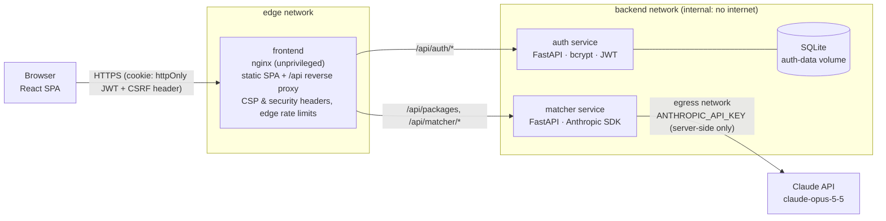

# Northstar AI Consultancy App

A security-first web app for an AI consultancy:

- **Login and registration**: React frontend, plus a dedicated **auth service** (FastAPI, **bcrypt**, **JWT**, **SQLite**).
- **Packages page** (authenticated): three monthly AI consultancy assistance tiers at **1,999 / 4,999 / 9,999 per month**.
- **Needs matcher** (authenticated): describe a client's needs, and **Claude** returns **1 to 4 key points** on which package fits and why. The results are filled into the package cards on both the matcher and the Packages page: your needs appear at the top, the best fit is marked "Recommended for you", and each key point sits on the card it's about. Specific things you mention (e.g. *emails*, *invoices*, *contracts*) are added to the package as extra **+ dot points**, each tagged with why (e.g. "You mentioned invoices").

**Privacy:** before the text goes to Claude, email addresses, URLs, IBANs and long numbers (phone, account, invoice numbers) are replaced with placeholders, and Claude is told not to repeat names or other confidential details. The text is never stored or logged on the server. In the browser it lives only in memory (no localStorage or sessionStorage), so it's gone on reload, logout or closing the tab.

Everything runs with a single `docker compose up --build`.

---

## Architecture



| Service    | Path                         | Tech                                  | Exposed?                         |
|------------|------------------------------|---------------------------------------|----------------------------------|
| `frontend` | `frontend/`                  | React 19 + Vite, served by nginx       | **Yes**, the only published port (8080) |
| `auth`     | `auth/`                      | FastAPI, bcrypt, PyJWT, SQLite         | No (internal network only)        |
| `matcher`  | `matcher/`                   | FastAPI, `anthropic` Python SDK        | No (internal + egress to Anthropic) |

The packages catalogue lives in [`matcher/app/packages.py`](matcher/app/packages.py). The packages page and Claude's prompt both read it, so prices and features can't drift apart.

### Why does the Claude call go through a backend?

The brief says *"the client side calls Claude"*. From the user's point of view it does: they click a button in the browser and get Claude's answer. But the browser never talks to `api.anthropic.com` directly:

1. **The API key would leak.** Anything shipped to the browser (bundled JS, env vars baked in at build time, or a key fetched at runtime) can be read in DevTools. A leaked key can be used to run up unlimited spend on your account and to access your organisation's API resources.
2. **No access control.** A direct browser call can't check that the caller is a logged-in customer.
3. **No abuse controls.** The server enforces input length limits, per-user rate limits and a daily cap, which a browser can't be trusted to enforce.
4. **Prompt integrity.** The system prompt, the package catalogue and the output schema stay on the server, so users can't rewrite the instructions or the prices.
5. **Output validation.** The server validates Claude's structured output (1 to 4 points, known package IDs) before anything reaches the UI.

So the flow is: browser → `POST /api/matcher/match` (session cookie + CSRF header) → matcher service (checks the JWT, validates input, rate-limits) → Claude → validated JSON → browser.

---

## Quick start (Windows PowerShell)

Prerequisites: [Docker Desktop](https://www.docker.com/products/docker-desktop/) running.

```powershell
cd consultancy-app
Copy-Item .env.example .env
# Generate a strong JWT secret and paste it into .env as JWT_SECRET=...
python -c "import secrets; print(secrets.token_urlsafe(48))"
# Optional: put your Claude API key in .env as ANTHROPIC_API_KEY=...
docker compose up --build
```

Open <http://localhost:8080>, create an account, then browse **Packages** and try the **Needs matcher**.

> **No API key?** With `MATCHER_MODE=auto` (the default) and no `ANTHROPIC_API_KEY`, the matcher runs a local keyword-based **mock** and the UI shows a "Demo mode" banner. Add a key and restart (`docker compose up -d matcher`) to use Claude.

Stop with `docker compose down`. Add `-v` to also delete the SQLite user database volume.

### Local development without Docker (optional)

```powershell
# terminal 1: auth on :8001
cd auth; python -m venv .venv; .venv\Scripts\pip install -r requirements.txt
$env:JWT_SECRET="<32+ byte secret>"; $env:DB_PATH="./auth.db"; $env:ALLOWED_ORIGINS="http://localhost:5173"; $env:COOKIE_SECURE="true"
.venv\Scripts\uvicorn app.main:app --port 8001

# terminal 2: matcher on :8002 (same JWT_SECRET)
cd matcher; python -m venv .venv; .venv\Scripts\pip install -r requirements.txt
$env:JWT_SECRET="<same secret>"; $env:ALLOWED_ORIGINS="http://localhost:5173"
.venv\Scripts\uvicorn app.main:app --port 8002

# terminal 3: React dev server on :5173 (proxies /api to the services)
cd frontend; npm install; npm run dev
```

---

## Environment variables

Set these in `consultancy-app/.env`. It is gitignored, so never commit it. Start from [`.env.example`](.env.example).

| Variable            | Required | Default                | Used by        | Description |
|---------------------|----------|------------------------|----------------|-------------|
| `JWT_SECRET`        | **yes**  | none                   | auth, matcher  | HS256 signing key, **at least 32 bytes**. The services refuse to start without it. |
| `ANTHROPIC_API_KEY` | no       | empty                  | matcher        | Claude API key. Server-side only; leave empty for mock mode. |
| `CLAUDE_MODEL`      | no       | `claude-opus-5-5`      | matcher        | Claude model ID. |
| `CLAUDE_EFFORT`     | no       | `medium`               | matcher        | `low` / `medium` / `high` / `xhigh` / `max`. Trades thoroughness against cost and latency. |
| `MATCHER_MODE`      | no       | `auto`                 | matcher        | `auto` (Claude if a key is set), `claude` (require a key), `mock`. |
| `ALLOWED_ORIGINS`   | no       | `http://localhost:8080`| auth, matcher  | Comma-separated CORS and Origin allowlist (exact match). |
| `APP_PORT`          | no       | `8080`                 | compose        | Host port for the web app. |
| `COOKIE_SECURE`     | no       | `true`                 | auth           | `Secure` flag on cookies. Browsers treat `http://localhost` as secure, so leave it `true`. |
| `JWT_TTL_MINUTES`   | no       | `15`                   | auth           | Session/token lifetime. |
| `BCRYPT_ROUNDS`     | no       | `12`                   | auth           | bcrypt cost factor. |
| `JWT_ISSUER` / `JWT_AUDIENCE` | no | `consultancy-auth` / `consultancy-app` | auth, matcher | Token `iss` / `aud` claims, verified on every request. |
| `CURRENCY`          | no       | `USD`                  | matcher        | ISO currency code for displayed prices. |
| `LOG_LEVEL`         | no       | `INFO`                 | auth, matcher  | Python log level. |

Advanced (set in the service environment if needed): `MAX_FAILED_LOGINS` (5), `LOCKOUT_MINUTES` (15), `LOGIN_RATE_PER_MIN` (10), `REGISTER_RATE_PER_HOUR` (20), `MATCH_RATE_PER_MIN` (5), `MATCH_RATE_PER_DAY` (50), `NEEDS_MAX_CHARS` (2000), `ENABLE_DOCS` (false).

---

## API

All endpoints are served under the nginx origin (`http://localhost:8080`). Request bodies are JSON (`Content-Type: application/json` is required on POSTs). *Auth* means a valid `access_token` cookie is required. *CSRF* means the `X-CSRF-Token` header must equal the `csrf_token` cookie.

| Method | Path                   | Auth | CSRF | Body                               | Success response |
|--------|------------------------|------|------|------------------------------------|------------------|
| POST   | `/api/auth/register`   | no   | no¹  | `{ "username", "password" }`       | `201` `{ id, username, expires_at }` + session cookies |
| POST   | `/api/auth/login`      | no   | no¹  | `{ "username", "password" }`       | `200` `{ id, username, expires_at }` + session cookies |
| POST   | `/api/auth/logout`     | opt. | yes² | none                               | `204`, cookies cleared |
| GET    | `/api/auth/me`         | yes  | no   | none                               | `200` `{ id, username, expires_at }` |
| GET    | `/api/packages`        | yes  | no   | none                               | `200` `{ currency, packages: [...] }` |
| POST   | `/api/matcher/match`   | yes  | yes  | `{ "needs": "10–2000 chars" }`     | `200` `{ recommended_package, key_points: [1–4 × { package_id, title, detail }], source: "claude" \| "mock" }` |
| GET    | `/healthz` (nginx), `/health` (services) | no | no | none                 | `200` |

¹ Pre-login requests have no session to ride on. They are protected by `SameSite=Strict`, the Origin allowlist and the JSON content-type requirement.
² Only enforced when a valid session exists.

Error codes: `401` not logged in or session expired, `403` CSRF or Origin check failed, `409` username taken, `415` wrong content type, `422` validation error (e.g. password policy, needs too long), `429` rate limited or account locked, `502/503` upstream AI error.

---

## Security notes

### Authentication
- **bcrypt** (cost 12) password hashing. Passwords over 72 bytes are rejected, because bcrypt silently ignores anything past that.
- **Password policy**: at least 12 characters, at least 3 of 4 character classes, must not contain the username, and a common-password blocklist.
- **Short-lived JWTs** (15 min, HS256 pinned; `exp`, `nbf`, `iss`, `aud` and `jti` all verified). Users sign in again when the token expires; there is deliberately no long-lived refresh token.
- **Constant-time-ish login**: when the username doesn't exist, the service still runs a bcrypt check against a dummy hash. Responses take the same time and return the same generic `Invalid username or password`. (Measured: about 0.23 s both ways.)
- **Brute-force protection** at three layers:
  1. nginx `limit_req` per IP on login/register,
  2. an in-app per-IP sliding window,
  3. **per-username lockout** (5 failures → 15 min), persisted in SQLite. It applies to non-existent usernames too, so lockout responses don't reveal which accounts exist.
- Registration necessarily reveals that a name is taken (`409`); a per-IP hourly limit slows enumeration through that endpoint.

### Session storage and CSRF
- The JWT is stored **only in an `httpOnly; Secure; SameSite=Strict` cookie**, never in `localStorage`, so XSS can't read it.
- **CSRF** uses a signed double-submit token. At login, a random `csrf_token` cookie (readable by JS) is issued, and **its SHA-256 is embedded in the JWT**. State-changing requests must echo it in `X-CSRF-Token`, and the server compares it in constant time. An attacker can't forge it, because they can neither read the cookie nor mint a JWT.
- In addition, an **Origin allowlist** rejects cross-site POSTs, and a JSON-only content-type rule blocks plain HTML form posts.

### Claude integration
- The API key exists only in the `matcher` container's environment (see [above](#why-does-the-claude-call-go-through-a-backend)).
- **Input**: 10–2000 characters, control characters stripped, `extra="forbid"` on the body schema. nginx also caps request bodies at 16 KB.
- **Prompt injection**: the user's text is wrapped in `<client_needs>` tags, and the system prompt tells Claude to treat it as untrusted data. Even a successful injection can only change text inside the validated schema; the model has no tools and no access to other data.
- **Structured output**: `client.beta.messages.parse(..., output_format=MatchResult)` constrains the response to a JSON schema (package IDs are an enum). The SDK and the server both re-validate that there are **1 to 4** points.
- **Refusals**: server-side `fallbacks: "default"` (beta `server-side-fallback-2026-07-01`) re-runs a safety-declined request on Anthropic's recommended fallback model. A final `refusal` returns a friendly `422`.
- **Abuse and cost controls**: per-user 5/min and 50/day, per-IP edge limit, a 90 s timeout with 2 SDK retries, and typed error handling (rate-limit vs API vs connection errors). Error details and keys are never echoed to the client.

### HTTP and infrastructure hardening
- **Security headers** (nginx, every response): strict `Content-Security-Policy` (`default-src 'self'`, no inline scripts, `frame-ancestors 'none'`, `object-src 'none'`), `X-Content-Type-Options`, `X-Frame-Options: DENY`, `Referrer-Policy: no-referrer`, `Permissions-Policy`, `Cross-Origin-Opener-Policy` and `Cross-Origin-Resource-Policy`. `server_tokens off`. API responses carry `Cache-Control: no-store`.
- **CORS**: explicit allowlist from `ALLOWED_ORIGINS` (never `*`). In the default setup everything is same-origin, so CORS is only a safeguard.
- **Containers**: slim images, **non-root** users (uid 10001 for the Python services, the unprivileged nginx image for the frontend), `read_only` root filesystems with `tmpfs` for `/tmp`, `cap_drop: ALL`, `no-new-privileges`, and healthchecks on every service.
- **Network segmentation**: only nginx publishes a port. `auth` sits on an `internal` network with **no internet access**. Only `matcher` gets an egress network, which it needs to reach Claude.
- **Secrets**: none in code or images. Services refuse to start with a missing or short `JWT_SECRET`. `.env` is gitignored, and `.dockerignore` keeps it out of build contexts.
- API docs (`/docs`) are disabled unless `ENABLE_DOCS=true`.

### Before going to production
- Terminate **TLS** in front of nginx and uncomment the `Strict-Transport-Security` header in [`frontend/nginx/security-headers.conf`](frontend/nginx/security-headers.conf). Set `ALLOWED_ORIGINS` to your real HTTPS origin.
- Use a secrets manager (Docker/K8s secrets, Vault, AWS Secrets Manager) instead of a `.env` file, and rotate `JWT_SECRET` and the API key.
- To scale beyond one replica, move the in-memory rate limiters to **Redis**. SQLite is fine for a single auth instance; use Postgres for multiple replicas.
- Consider asymmetric JWTs (RS256/EdDSA) so the matcher only holds a public key, plus a token denylist (`jti`) for instant revocation.
- Account lockout can be abused to lock out a known user (a DoS risk). Pair it with CAPTCHA or step-up verification and monitoring.
- Add MFA, audit logging and alerting (failed logins, 429 spikes, Claude spend), plus dependency and image scanning (e.g. `pip-audit`, `npm audit`, Trivy) in CI.

---

## Project layout

```
consultancy-app/
├── docker-compose.yml
├── .env.example
├── auth/                 # FastAPI auth service (SQLite, bcrypt, JWT cookies)
│   ├── app/main.py
│   ├── app/ratelimit.py
│   └── Dockerfile
├── matcher/              # FastAPI packages + Claude needs matcher
│   ├── app/main.py
│   ├── app/packages.py   # single source of truth for tiers and prices
│   └── Dockerfile
└── frontend/             # React (Vite) SPA served by nginx
    ├── src/              # App, pages (Login, Register, Packages, Matcher), api.js
    ├── nginx/            # default.conf (proxy, rate limits), security-headers.conf
    └── Dockerfile        # multi-stage: node build → nginx-unprivileged
```
